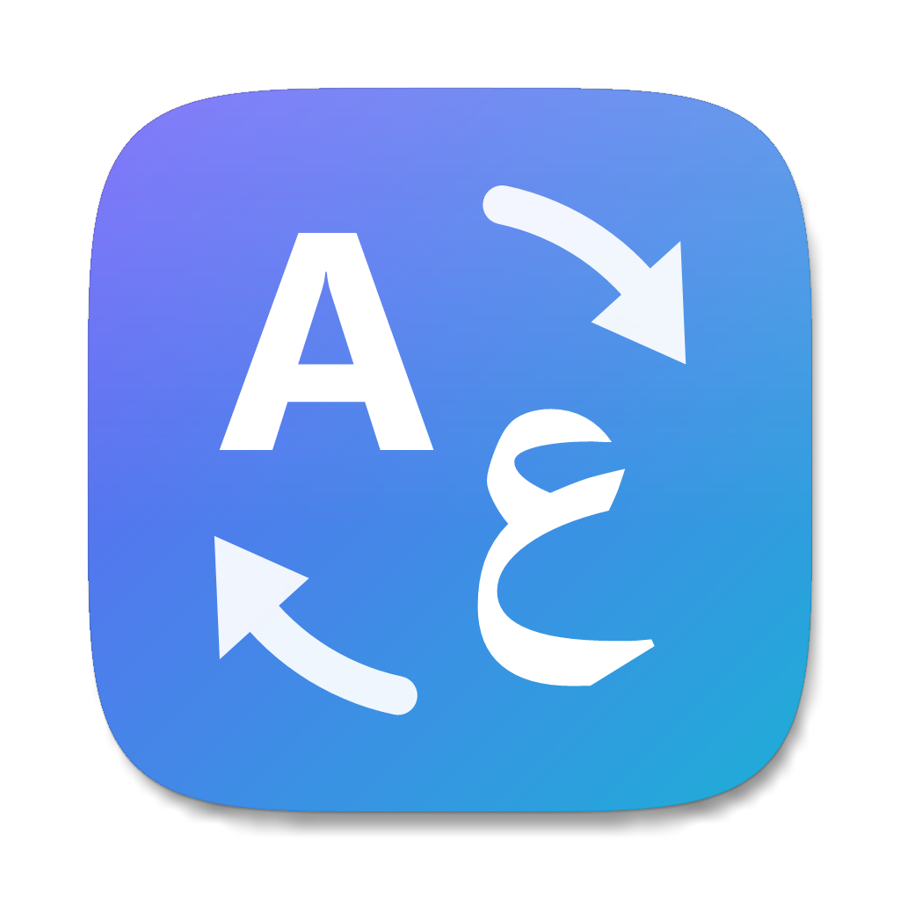

# لخفنه

**كتبت كلام كتير وطلع الكيبورد على اللغة الغلط؟ حدده ودوس اختصار — لخفنه يقلبه للغة الصح.**

`hgsghl ugd;l` ← **السلام عليكم**

[⬇️ تحميل للويندوز](https://github.com/elmonofy/lakhfana/releases/latest/download/Lakhfana.exe) ·
[⬇️ تحميل للماك](https://github.com/elmonofy/lakhfana/releases/latest/download/Lakhfana.dmg) ·
[كل الإصدارات](https://github.com/elmonofy/lakhfana/releases)

Lakhfana fixes text typed in the wrong keyboard layout (Arabic ⇄ English and any other pair): select it, press a hotkey, and every character is re-typed as if the same keys had been pressed in the other layout. Windows 10/11 and macOS 13+.

---

## بيعمل إيه

لو كتبت وانت فاكر الكيبورد عربي وطلع إنجليزي (أو العكس)، لخفنه بيبدّل كل حرف بالحرف اللي على **نفس الزرار** في اللغة التانية:

| كتبت | بعد لخفنه |
|---|---|
| `hgsghl ugd;l` | السلام عليكم |
| `شلاخعف` | about |
| `اثممخ صخقمي` | hello world |
| `hgsghl عليكم` (متلخبط) | السلام ugd;l — كل كلمة بتتقلب لوحدها |

- **من غير تحديد؟** بيحدد السطر اللي انت واقف فيه لوحده ويقلبه.
- **دوست الاختصار تاني على نفس الكلام؟** بيرجّعه زي ما كتبته بالظبط.
- **الكيبورد بيتغيّر لوحده** للغة الصح بعد التحويل، عشان تكمّل كتابة على طول.
- **الحافظة بترجع زي ما كانت** — اللي كنت ناسخه قبلها مش بيضيع، ومش بيملا سجل الحافظة (Win+V).
- بيقرا الكيبورد المتسطّب عندك فعلاً، فبيشتغل مع العربي والإنجليزي وأي لغتين تانيين.

## التسطيب

### ويندوز (10 أو 11)

1. حمّل [`Lakhfana.exe`](https://github.com/elmonofy/lakhfana/releases/latest/download/Lakhfana.exe) وافتحه.
2. لو ظهرت رسالة **Windows protected your PC**: دوس **More info** وبعدين **Run anyway** (البرنامج لسه مش متمضي رقمياً).
3. في شاشة الترحيب اختار الاختصار (الافتراضي **Ctrl + Shift + Space**) ودوس **يلا نبدأ**.

البرنامج بيتسطّب لوحده (من غير صلاحيات Administrator) وبيظهر في قايمة Start وفي **Apps & features**، وأيقونته بتستناك جنب الساعة.

### ماك (macOS 13 أو أحدث — Apple Silicon و Intel)

1. حمّل [`Lakhfana.dmg`](https://github.com/elmonofy/lakhfana/releases/latest/download/Lakhfana.dmg)، افتحه واسحب **Lakhfana** على **Applications**.
2. افتحه من Applications. الماك هيقول إنه مش قادر يتأكد منه — روح **System Settings ← Privacy & Security** وانزل لتحت ودوس **Open Anyway**.
3. في شاشة الترحيب اختار الاختصار (الافتراضي **⌃⇧Space**) وفعّل صلاحية **Accessibility** للخفنه — من غيرها مش هيقدر ينسخ ويلزق.

تفاصيل أكتر للماك في [mac/README.md](mac/README.md).

## الاستخدام

1. حدد الكلام اللي اتكتب غلط (مثلاً **Ctrl+A** على ويندوز أو **⌘A** على الماك) — أو متحددش حاجة وخليه يحدد السطر.
2. دوس الاختصار.
3. خلاص 🙂

من أيقونة البرنامج (جنب الساعة على ويندوز، وفوق في شريط القوايم على الماك) تقدر تفتح **الإعدادات** أو **توقّفه مؤقتاً** أو **تقفله**.

### الإعدادات

| الإعداد | بيعمل إيه |
|---|---|
| اختصار التحويل | تغيّر الاختصار؛ البرنامج بيرفض الاختصارات المهمة (زي Ctrl+C) والمستخدمة في برامج تانية |
| اللغتين | لو عندك أكتر من لغتين كيبورد، تختار أنهي اتنين يتقلبوا بينهم |
| يشتغل مع الويندوز / لما الماك يفتح | يفتح لوحده أول ما الجهاز يشتغل |
| يغيّر لغة الكيبورد بعد التحويل | يحوّل الكيبورد للغة اللي الكلام اتقلب لها |
| لو مفيش كلام متحدد، يحدد السطر لوحده | يقلب السطر الحالي لو مفيش تحديد |

## الخصوصية

- لخفنه **مش بيتصل بالإنترنت** خالص ومش بيجمع أي بيانات.
- مش بيقرا أي حاجة غير الكلام اللي انت بتحدده لحظة ما تدوس الاختصار.
- مش بيشتغل في خانات الباسورد.
- الإعدادات متخزّنة على جهازك بس:
  - ويندوز: `%APPDATA%\Lakhfana\settings.ini`
  - ماك: `defaults read com.lakhfana.app`

## مشاكل ممكن تقابلك

| المشكلة | الحل |
|---|---|
| الاختصار مش بيعمل حاجة في برنامج معيّن على ويندوز | لو البرنامج ده شغال **كـ Administrator**، الويندوز مش بيسمح لبرنامج عادي يكتب فيه. شغّل لخفنه كـ Administrator أو جرّب في برنامج تاني. |
| «الاختصار ده مستخدم في برنامج تاني» | اختار اختصار تاني من الإعدادات. |
| على الماك بطّل يشتغل بعد التحديث | **System Settings ← Privacy & Security ← Accessibility**: شيل Lakhfana من القايمة وضيفه تاني (لأن البرنامج لسه مش متمضي من Apple). |
| «حدد الكلام الأول» في المتصفح | لما مش واقف في خانة كتابة، البرنامج مش بيحدد السطر لوحده عشان ميرجّعكش صفحة لورا. حدد الكلام بنفسك. |
| «لازم يبقى عندك لغتين كيبورد على الأقل» | ضيف لغة كيبورد تانية من إعدادات الجهاز. |
| الأرقام بقت ١٢٣ على الماك | كيبورد الماك العربي بيكتب الأرقام هندي — ده اللي الزراير بتكتبه فعلاً. |

لو حصلت مشكلة على ويندوز، في ملف بالتفاصيل هنا: `%APPDATA%\Lakhfana\error.log`.

## إلغاء التثبيت

- **ويندوز:** Settings ← Apps ← Installed apps ← **لخفنه** ← Uninstall، أو من إعدادات البرنامج «إلغاء تثبيت البرنامج».
- **ماك:** اقفل لخفنه من أيقونته، اسحبه من Applications للـ Trash، وشيله من قايمة Accessibility.

## للمطورين

البرنامج مكتوب من غير أي مكتبات خارجية:

- **ويندوز:** C# 5 و WinForms، بيتبني بالـ compiler اللي جوه الويندوز نفسه (`build.ps1`) — مش محتاج Visual Studio ولا .NET SDK.
- **ماك:** Swift package (AppKit + SwiftUI).

إزاي يتبني ويتختبر ويتنشر، وإزاي بيشتغل من جوه: [docs/DEVELOPMENT.md](docs/DEVELOPMENT.md).

---

Created by **Abdelrahman Elmonofy** · [fullstack.elmonofy.dev](https://fullstack.elmonofy.dev)

